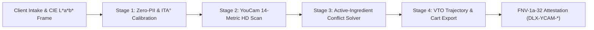

# Architecture Specification — DermaLux Studio

## System Pipeline

## Module Breakdown

1. **`src/lib/skin/youcam-skin-analyzer.ts`**:
   - Computes $\text{ITA}^\circ = \text{atan2}(L^* - 50, b^*) \times \frac{180}{\pi}$.
   - Maps $\text{ITA}^\circ$ to `FITZPATRICK_I` through `FITZPATRICK_VI`.
   - Applies subclinical erythema hemoglobin compensation and melanin-fairness baseline normalization across the 14 YouCam HD metrics.

2. **`src/lib/regimen/active-conflict-solver.ts`**:
   - Evaluates pairwise active ingredient classes (`RETINOID`, `AHA_BHA`, `BENZOYL_PEROXIDE`, `VITAMIN_C_LAA`, `AZELAIC_NIACINAMIDE`, `CERAMIDE_PEPTIDE`, `MINERAL_SPF_TINT`, `GENTLE_SURFACTANT`).
   - Synthesizes a 4-step AM (`CLEANSE`, `TREAT`, `MOISTURIZE`, `SPF_FINISH`) and 3-step PM (`CLEANSE`, `TREAT`, `REPAIR`) eCommerce regimen within the user's budget ceiling.

3. **`src/lib/vto/vto-trajectory-exporter.ts`**:
   - Projects `IMMEDIATE_VTO`, `WEEK_4_VTO`, and `WEEK_8_VTO` metric improvements and CIE $L^*a^*b^*$ tint deltas ($\Delta L^* \le 1.5$ zero white-cast check).
   - Exports JSON Schema Draft 2020-12 cart bundles, RFC 5545 `.ics` adherence schedules, and Markdown clinical summaries.

4. **`src/lib/youcam/youcam-vto-supervisor.ts`**:
   - Enforces a `4500ms` `AbortController` circuit breaker and seals the regimen state with an FNV-1a-32 hash (`DLX-YCAM-<HEX8>`).
